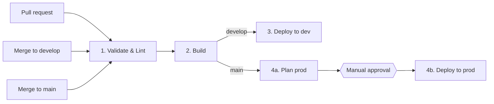
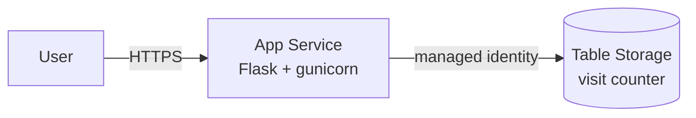

# Multi-Environment Deployment on Azure

A small web app that counts visits, deployed to two Azure environments (dev and
prod) by a multi-stage Azure DevOps pipeline. Terraform provisions the
infrastructure; production deployments wait for a manual approval.

| | |
|---|---|
| **App** | Python 3.12, Flask, gunicorn |
| **Infrastructure** | Terraform (azurerm 4.x): App Service (Linux), Storage Account (Table) |
| **CI/CD** | Azure DevOps Pipelines (YAML, multi-stage, templates) |
| **Security** | Managed identity + RBAC for storage access, no secrets in app settings, HTTPS only |

## How it works



| Stage | What it does |
|---|---|
| **Validate & Lint** | `terraform fmt -check`, `terraform validate`, `tflint`; `ruff` and `pytest` for the app |
| **Build** | Zips the app and publishes it as a pipeline artifact. The same artifact goes to every environment |
| **Deploy to dev** | On `develop`: `terraform apply` with `dev.tfvars`, zip deploy, smoke test of `/health` |
| **Plan prod** | On `main`: `terraform plan` with `prod.tfvars`, so the approver can see what will change |
| **Deploy to prod** | Waits for approval on the `production` environment, then apply, deploy, smoke test |

Pull requests run only Validate and Build.

### Infrastructure per environment



Each environment has its own resource group and its own Terraform state file
(`dev.tfstate`, `prod.tfstate`) in a shared storage account. The same Terraform
code is used for both; only the variable files differ:

| | dev | prod |
|---|---|---|
| App Service plan | B1 | S1 |
| Always On | off | on |
| Storage replication | LRS | GRS |

The counter is one Table Storage entity. Increments use optimistic concurrency
(ETag checks with retries), so they stay correct when the app runs on several
instances.

## Repository layout

```
app/                        Flask app (app.py, store.py)
tests/                      Unit tests
terraform/                  Infrastructure code
  environments/             dev.tfvars, prod.tfvars
azure-pipelines.yml         Pipeline definition
pipelines/templates/        Reusable pipeline templates
pipelines/scripts/          Terraform wrapper used by the pipeline
scripts/bootstrap-backend.sh  One-time Terraform state storage setup
```

## Run locally

```bash
python -m venv .venv && source .venv/bin/activate
pip install -r requirements-dev.txt
pytest
python app/app.py   # http://localhost:8000
```

Without `STORAGE_TABLE_ENDPOINT` set, the counter is kept in memory.

## Setup

You need an Azure subscription, an Azure DevOps organization and the Azure CLI.

1. **Terraform state storage.** Log in with `az login`, then run:

   ```bash
   ./scripts/bootstrap-backend.sh
   ```

   Copy the printed storage account name into `tfStateStorageAccount` in
   [azure-pipelines.yml](azure-pipelines.yml).

2. **Service connection.** In Azure DevOps: *Project settings → Service
   connections → New → Azure Resource Manager* (workload identity federation is
   recommended), scoped to the subscription. Name it `azure-service-connection`,
   or change `azureServiceConnection` in the pipeline.

3. **Permissions.** Terraform creates a role assignment (the web app's access to
   the table), which the default *Contributor* role cannot do. Give the service
   connection's service principal the **Role Based Access Control
   Administrator** role on the subscription as well (*Subscription → Access
   control (IAM) → Add role assignment*).

4. **Environments.** In *Pipelines → Environments* create `dev` and
   `production`. On `production` open *Approvals and checks → Approvals* and add
   yourself as approver. This is the manual gate before production.

5. **Pipeline.** *Pipelines → New pipeline → GitHub*, pick this repository and
   the existing `azure-pipelines.yml`. On the first run, allow the pipeline to
   use the service connection and the environments when prompted.

6. **Branches.** Create a `develop` branch. Merging to `develop` deploys to dev,
   merging to `main` deploys to production after approval.

## Clean up

The App Service plans are billed for as long as they exist. To remove
everything, delete the resource groups:

```bash
az group delete --name rg-hellovisits-dev --yes
az group delete --name rg-hellovisits-prod --yes
az group delete --name rg-tfstate --yes
```

## Possible improvements

- Apply the exact plan that was approved (publish the plan file from *Plan prod*)
- Deployment slots with swap for zero-downtime production releases
- Application Insights and alerts
- Private endpoint for the storage account
